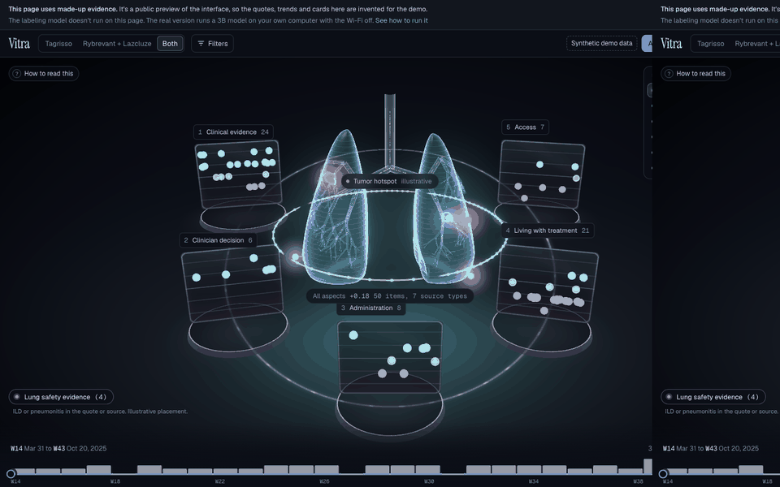
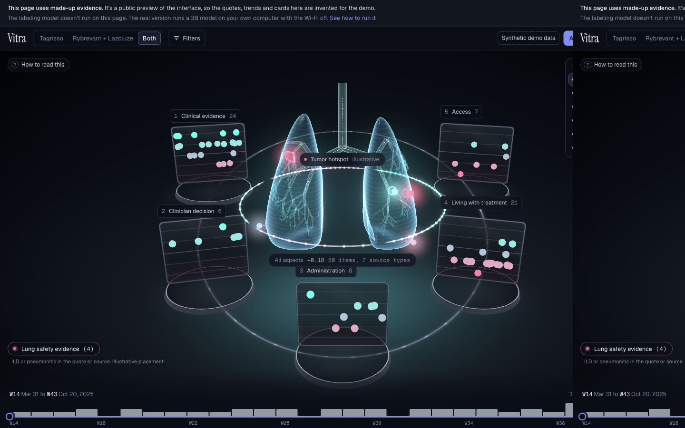
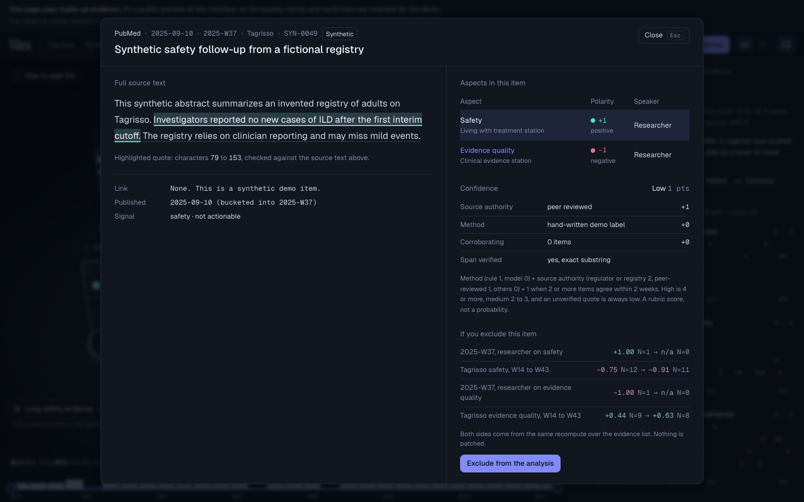

<p align="center">
  
</p>

<h1 align="center">Vitra</h1>

<p align="center">
  <strong>Ashsmith Khayrul</strong> · HACK1984 · Signal-to-Dose
</p>

<p align="center">
  Reads public evidence on Tagrisso and Rybrevant, labels the launch signal, and ties every score to an exact quote.<br />
  Runs a 3B model on your machine with no Wi-Fi.
</p>

<p align="center">
  <a href="https://vitra.khayrul.com">Live demo</a>
  ·
  <a href="#results-dev">Results</a>
  ·
  <a href="#demo-video">Video</a>
  ·
  <a href="#setup-and-run-local-offline">Run offline</a>
</p>

<p align="center">
  
</p>
<p align="center">
  <sub>Synthetic fixture. Click a quote to open Evidence X-Ray. Lungs are illustrative; every span is an exact substring of its source.</sub>
</p>

<p align="center">
  
  &nbsp;
  
</p>

## Who it's for

An EGFR NSCLC launch-intel or medical-affairs lead. They need week-over-week sentiment with citations they can open, and they cannot paste private advisory-board notes into a cloud model. Vitra is built around Within3's frame: **understand**, **interrogate**, **act**, with AI you can trace.

## Results (dev)

Official `score.py` on the **60-item** labeled dev set (5-fold). Hidden test is 240 items, scored by organizers.

| | Rules only (r2) | Rules + Llama 3.2 3B hybrid |
|---|---|---|
| **Composite** | 0.842 | **0.8466** |
| Signal macro-F1 | | 0.806 |
| Actionable F1 | | 0.917 |
| Aspect F1 | | 0.703 |
| Polarity QWK | | 0.917 |
| Speaker accuracy | | **1.000** |
| Span F1 | | 0.583 |
| Citation validity | | **1.000** |

Hybrid was tuned on dev, so 0.8466 is an upper bound. Weak spot: aspects and quotes on long PubMed / press (rules-only aspect F1 **0.328**). Cost on an Apple M5 MacBook Air (16 GB): **268.3 s per 100 items** (logged hybrid test run). Organizer hardware unknown.

## One public item, end to end

Public source: [Rybrevant Faspro PI](https://dailymed.nlm.nih.gov/dailymed/drugInfo.cfm?setid=9e58b045-e352-4f62-99bf-77fae1bebc69) (DailyMed), dosage section: subcutaneous injection under the skin of the abdomen over about 5 minutes, versus IV Rybrevant.

Vitra would typically emit:

| Field | Example |
|---|---|
| Signal | access / convenience update |
| Aspect | convenience, speaker often HCP or label |
| Polarity | positive on chair-time / route |
| Span | an exact substring of that label sentence (never paraphrased) |

In the UI that span lights up in Evidence X-Ray, lands on the Administration station, and can move the convenience trend for product B.

## Demo video

<a id="demo-video"></a>

3 to 5 min walkthrough (YouTube). Link lands here when the upload is ready: Wi-Fi off, cold `run_offline.sh`, lungs, X-Ray, one pasted transcript with real stage timings.

## How it works

1. **Ingest** public JSONL (and private paste tagged local-only).
2. **Rules** handle clear FDA / trial / speaker cases from the labeling guide.
3. **Local Llama 3.2 3B** (Q4_K_M, JSON schema) fills the rest on `127.0.0.1:8080`.
4. **Span snap** keeps every quote as an exact substring; failed snaps drop.
5. **Aggregate** trends, gaps, insight cards, what-if exclude/restore.
6. **Serve offline** on loopback; `run_offline.sh --check` audits sockets.

```
pipeline/   rules + model + spans
app/        local API
web/        React + three.js
contracts/  shared shapes
```

**Real:** labels, spans, trends, offline run. **Illustrative:** 3D anatomy. **Synthetic:** [vitra.khayrul.com](https://vitra.khayrul.com). Not medical advice. Code MIT; model under Llama 3.2 Community License (weights not in repo). See `LICENSES.md`.

## Setup and run (local, offline)

Runs on macOS (Apple Silicon or Intel), Linux and Windows. Needs ~8 GB free RAM, Python 3.11+, Node 20+, `llama-server` on PATH, and the organizer package under `starter/` (gitignored; PubMed rehydrated). On macOS, `brew install llama.cpp` gives you `llama-server` on both chip types. Apple Silicon and machines with an NVIDIA or AMD GPU run the model fastest; Intel Macs and CPU-only machines work too, just slower.

```bash
python3 -m venv .venv && .venv/bin/pip install -r requirements.txt
(cd web && npm ci && npm run build)
# Model: Llama-3.2-3B-Instruct-Q4_K_M.gguf from huggingface.co/bartowski/Llama-3.2-3B-Instruct-GGUF into models/
# sha256 6c1a2b41161032677be168d354123594c0e6e67d2b9227c84f296ad037c728ff

scripts/run_offline.sh --check
scripts/run_offline.sh serve
```

`serve` prints `X-Vitra-Token for this launch: …` and opens `http://127.0.0.1:8000/#t=…`. No signup. No fixed token in the repo.

### Windows

Same launcher, same flags. In PowerShell from the repo root:

```powershell
py -3 -m venv .venv
.venv\Scripts\python.exe -m pip install -r requirements.txt
cd web
npm ci
npm run build
cd ..
# models\Llama-3.2-3B-Instruct-Q4_K_M.gguf
# llama-server.exe: unzip a Windows build from github.com/ggml-org/llama.cpp/releases
# (the cpu-x64 build needs no GPU; cuda and vulkan builds use one), then put its folder on PATH or:
$env:VITRA_LLAMA_SERVER = "C:\llama.cpp\llama-server.exe"

scripts\run_offline.ps1 --check
scripts\run_offline.ps1 serve
```

If PowerShell blocks local scripts, use `scripts\run_offline.cmd --check` with the same arguments. Ctrl+C stops the model server and the API. WSL2 also works: follow the Linux steps inside a WSL shell, and if no browser opens, paste the printed URL into your Windows browser.

All three entry points (`run_offline.sh`, `.ps1`, `.cmd`) run `python -m app.launch`, so the checks and the socket audit are the same code on every OS.

```bash
.venv/bin/python -m pipeline.predict --split unlabeled --out data/derived/predictions/unlabeled.jsonl
PKG=starter/hackathon_package_2026-11-05
.venv/bin/python -I "$PKG/scoring/score.py" \
  --gold "$PKG/data/dev.jsonl" \
  --pred data/derived/dev_pred.jsonl \
  --items "$PKG/data/dev.full.jsonl"
```

## Network off

`--check` refuses to run while `example.com:443` accepts a connection, starts model + API on loopback only, serves the prebuilt web same-origin, runs one SYNTHETIC intake, and checks the sockets of every Vitra process with psutil every 0.3 s. Any socket it sees that isn't loopback fails the run with exit code 4. On Windows it flags every UDP socket, because Windows doesn't report where UDP traffic goes.
